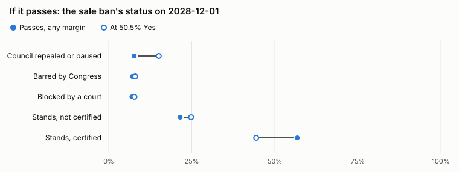
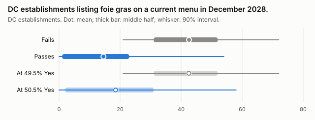
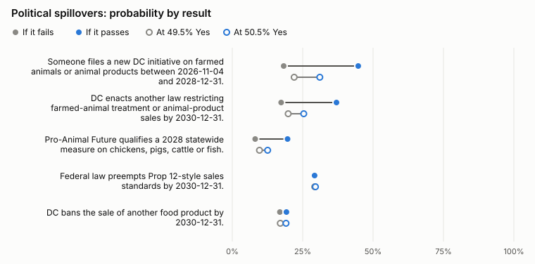

DC voters, including me, decide Initiative 86 on November 3: whether to ban force-feeding birds and selling "fattened bird liver products" in the District from July 1, 2027. Pro-Animal DC, which [WJLA describes](https://wjla.com/features/i-team/dc-voters-to-decide-foie-gras-ban-after-initiative-86-qualifies-for-november-ballot-controversial-cuisine-what-is-foie-gras-pro-animal-dc-august-2026) as a campaign of Pro-Animal Future, led the petition drive. The Restaurant Association Metropolitan Washington and Butterworth's owner Bart Hutchins [have spoken against the ban](https://wjla.com/features/i-team/dc-voters-to-decide-foie-gras-ban-after-initiative-86-qualifies-for-november-ballot-controversial-cuisine-what-is-foie-gras-pro-animal-dc-august-2026). Denver votes on [its own foie gras sales ban](https://hoodline.com/2026/09/denver-voters-to-decide-foie-gras-ban-restaurants-face-5-000-fines/) the same day, two years after Pro-Animal Future backed bans on [fur sales](https://denverite.com/2024/11/05/denver-ballot-measure-308-results-2024-elections/) and [slaughterhouses](https://denverite.com/2024/11/05/denver-ballot-measure-309-results-2024-elections/) there that [drew about 42% and 35% Yes](https://hoodline.com/2026/09/denver-voters-to-decide-foie-gras-ban-restaurants-face-5-000-fines/).

Pro-Animal DC [counted](https://proanimaldc.org/faq/) about 48 DC restaurants with foie gras on the menu in December 2025, many of them only in season. In April 2026, researchers at Colorado State University and UC Berkeley [scanned menus](https://sites.warnercnr.colostate.edu/animalhumanpolicy/ahpc-studies-document-the-prevalence-of-foie-gras-on-menus-and-denver-voters-support-of-a-foie-gras-ban/) across the Washington metro area, [confirmed 17](https://drive.google.com/file/d/1Mc7enjYchgzfH44wjq4B6Y6HgyOtoc_O/view?usp=sharing) as current and found 32 more only on a listing site that keeps closed restaurants. Before the vote, I asked AI forecasters what passage sets in motion: whether it makes further farmed-animal measures likelier, and whether it changes the odds that federal law preempts state sales standards. I also asked whether the ban survives the DC Council, Congress and the courts, whether DC would enforce it against ordinary poultry-liver pâté, and what happens to restaurant jobs.

The forecasters expect passage to make further farmed-animal measures likelier. They give 22% to someone filing a new DC initiative on farmed animals or animal products by the end of 2028 after a bare fail at 49.5% Yes, and 31% after a bare pass at 50.5%. For a further DC law restricting farmed-animal treatment or animal-product sales by the end of 2030, they give 20% and 25%. Their chance that federal law preempts state sales standards by the end of 2030 stays near 29% either way.

## How the forecast works

I built a causal map of 22 questions, in the spirit of Metaculus's [Radiant](https://forum.effectivealtruism.org/posts/m8i8dbotR7SwsLou3/map-the-future-before-you-build-it). Each asks for a probability or a quantity in its own unit, such as establishments, jobs, dollars or birds, and all but one name the source or check that will settle it. If the measure passes, one question asks which of five statuses the sale ban has on December 1, 2028. Either the Council has repealed or paused it, Congress has barred it, a court has blocked it, or it stands with or without a funding certification from DC's chief financial officer (CFO). That status feeds the direct outcomes, such as menus and sales tax, and the vote feeds the political ones.

Eight forecasters answered every question: four runs of Claude Opus 5.5 and four of GPT-6.1 Sol. Each got the same prompt, researched on its own with web search, and gave a distribution for the Yes share. It then answered each question at up to five official Yes shares (42%, 49.5%, 50.5%, 60% and 72%), and separately for each outcome of the questions that feed it, such as whether the ban stands. For quantities, it gave the 5th, 25th, 50th, 75th and 95th percentiles. A simulator runs each forecaster's answers through the map, 20,000 draws per condition, and pools the eight forecasters with equal weights.

If you compare worlds where the measure passes with worlds where it fails, you mix what passing does with what a big Yes vote says about voters. Denver votes the same day, so DC's result cannot change Denver's. Yet the forecasters put the chance that Denver passes its ban at 42% in worlds where DC's measure fails and 73% where it passes. With no causal path, that 31-point gap comes from what DC's margin tells them about voters. So the simulator also runs the map at Yes shares of 49.5% and 50.5%, with the same random draws at both. It subtracts the first result from the second to get the cutoff effect: the forecasters' estimate of what a bare pass changes. Economists use the same comparison, a [regression discontinuity](https://mixtape.scunning.com/06-regression_discontinuity), to learn what passing does from measures that barely pass or fail. At both shares, the simulator holds Denver's chance at the midpoint of each forecaster's answers for 49.5% and 50.5%, so a bare pass cannot move that chance. The forecasters still read a little about voters into one point of margin: their own Denver answers move one or two points between 49.5% and 50.5%. A cutoff effect of one or two points could come from either source.

I published every prompt, transcript and answer, and the simulator, in a [repository](https://github.com/MaxGhenis/dc-i86-llm-forecast). Its audit parses each forecaster's tool calls, and the simulator leaves out any run the audit finds reading another run's files or the repository. The simulator also leaves out three Opus runs whose answers did not fit the response format. The audit flagged no call in the eight pooled runs, including two Opus runs that I started after collecting the first answers. It catches casual reads, and a forecaster that set out to hide one could get past it. On October 26 I hashed the run files and pooled results and [timestamped](https://github.com/MaxGhenis/dc-i86-llm-forecast/tree/main/prereg) the lists of hashes with OpenTimestamps; the last list matches the current files.

## The vote

The forecasters put the measure's chance of passing at 89.7%, with mean Yes shares from 60% to 65% across the eight. They put 5.7% on a pass with 50–53% of the vote and 4.1% on a fail with 47–50%. From those distributions and their turnout forecasts, I estimate one ballot's chance of deciding the measure at about 1 in 250,000. In a 2023 [poll](https://proanimal.org/78-of-dc-voters-want-to-end-the-sale-of-force-fed-foie-gras/) that DC Voters for Animals commissioned and Pro-Animal Future published, Dynata found that 78% of 438 registered DC voters supported prohibiting the sale of foie gras made by force-feeding. Seven of the eight forecasters discounted that poll for its sponsors, its age, its sample or its wording, which differs from the ballot's, and six expected opposition from chefs to cost Yes votes.

## Whether the ban sticks

Under section 8 of the measure, any provision with a fiscal effect applies from the date an approved budget and financial plan includes that effect, if that date falls after July 1, 2027. The CFO must certify the date. In a [fiscal impact statement](https://dcboe.org/getmedia/8ed77952-835c-4a11-9fa2-2ad447d82643/Final-FIS-Initiative-Prohibiting-the-Force-Feeding-of-Birds-Act-of-2026.pdf), the CFO's office estimates the cost at $314,000 over four years and finds that the fiscal 2026–2029 budget and financial plan lacks the funds. Across all passing margins, the forecasters put the chance that the sale ban stands with that certification on December 1, 2028, at 57%, and without it at 22%. They give 8% to the Council repealing or pausing the ban, 7% to a congressional bar and 7% to a court block. At a bare pass, they put a Council repeal or pause at 15% and the certified ban at 44%.

*Filled dots show the average over every passing margin; rings show a bare pass at 50.5% Yes.*

The Council voted in October 2018 to [repeal Initiative 77](https://ballotpedia.org/Washington,_D.C.,_Initiative_77,_Minimum_Wage_Increase_for_Tipped_Workers_%28June_2018%29), which voters had passed with 56% that June to phase out the tipped minimum wage. In 2025 it [paused and scaled back](https://ballotpedia.org/Washington,_D.C.,_Initiative_82,_Increase_Minimum_Wage_for_Tipped_Employees_Measure_%282022%29) Initiative 82, which voters had passed with 74% in 2022. All eight forecasters cited the Council's record of changing initiatives, and the four Opus runs judged foie gras low-stakes for the Council, with repeal likeliest after a narrow win. If the measure passes, the forecasters put the chance of a lawsuit against it at 61%. Six of the eight cited California's foie gras ban, which courts upheld and the Supreme Court [declined to review](https://www.supremecourt.gov/docket/docketfiles/html/public/17-1285.html) in 2019, as evidence against a court block of the whole ban.

## Menus, pâté and restaurants

If the measure fails, the forecasters expect about 43 DC establishments to list foie gras on a current menu in December 2028; if it passes, about 15. A bare pass takes the count from about 43 to 19. If the ban still stands and the CFO has certified its funding, the eight forecasters' median counts fall to between 1 and 4 establishments. If it stands uncertified, they fall to between 11 and 28, against 28 to 50 if the measure fails.

Once the ban applies, no one in DC may sell or serve a product "made from the livers of birds fattened through any method or practice, including foie gras, pâtés, spreads, and processed meat products derived from such livers, regardless of marketing terminology." DC's Department of Energy and Environment (DOEE) would enforce the ban. Every forecaster read those words as wide enough to cover ordinary poultry-liver pâté, and expected DOEE to follow the measure's focus on force-feeding. If the ban stands, they give 42% to a DOEE rule or Council act, by December 2028, that excludes liver from birds that farmers did not force-feed. They give 5% to DOEE treating such a product as banned. They disagree on how many DC menus list other liver pâtés, mousses or terrines: the Opus runs put the count near 120 to 150, the Sol runs near 40 to 70. Pooled, a bare pass cuts that count by about three.

A bare pass changes the pooled forecasts of DC restaurant employment, sales tax on food and drink, and Michelin-starred restaurants by less than 0.1% each. Nationally, they expect US foie gras farms to force-feed about 386,000 ducks and geese in 2030 if DC's measure fails, and about 7,900 fewer, 2% of the total, at a bare pass. No official source counts those birds, so I log that question without scoring it.

## Political spillovers

For most spillover questions, a bare pass accounts for about a fifth to a third of the gap between failing and passing worlds. The rest of the gap tracks the size of the margin, and I cannot separate what a big Yes vote reveals about voters from any momentum a bigger win adds. The forecasters put the chance that someone files a new DC initiative on farmed animals or animal products by the end of 2028 at 18% if the measure fails and 45% if it passes. A bare pass raises it from 22% to 31%. A bare pass also raises the chance of a further DC law restricting farmed-animal treatment or animal-product sales by the end of 2030 from 20% to 25%. It raises the chance that Pro-Animal Future qualifies a 2028 statewide measure on chickens, pigs, cattle or fish from 10% to 13%. At a bare fail, they expect farmed-animal laws that states and localities enact from 2027 through 2032 to newly cover about 25 million US residents, and a bare pass adds about 1.15 million. I left DC's foie gras laws and Denver's measure out of both counts.

*Filled dots show averages over every failing or passing margin; rings show a bare fail at 49.5% Yes and a bare pass at 50.5%. The gap between the rings shows what the forecasters expect a bare pass to change. The forecasters answered the last two questions only at 49.5% and 50.5%.*

For a new DC initiative, the Sol runs reasoned that a win shows the initiative route works and helps fundraising. The Opus runs reasoned that Pro-Animal Future runs a series of local measures, so a win makes another DC filing likelier; two of them added that a loss makes the group likelier to turn elsewhere. A bare pass moves the pooled forecast that federal law preempts sales standards like California's Proposition 12 by the end of 2030 from 29.3% to 29.5%. The Opus runs put that chance at 12% to 26%, the Sol runs at 36% to 47%. A bare pass raises the chance that DC bans the sale of another food by the end of 2030 from 17% to 19%.

I multiply each forecaster's cutoff effect by that forecaster's chance that one ballot decides the measure, then average over the eight. Compared with abstaining, one ballot's expected effect comes to about five more US residents under new state and local farmed-animal laws, three hundredths of a force-fed bird in 2030 and a ten-thousandth of a DC establishment listing foie gras. A Yes ballot adds the residents and removes the birds and the listing; a No ballot does the reverse.

## How the two models differ

The Opus and Sol runs agree on the measure's chance of passing: the Opus runs give it 87% to 94%, and the Sol runs 86% to 90%. They also agree on how much a bare pass raises the chance that someone files a new DC initiative: by 9.3 points in the average Opus run and 8.9 in the average Sol run.

They differ on how much farmed-animal law follows. For a further DC law restricting farmed-animal treatment or animal-product sales by the end of 2030, the Sol runs give 50% to 61% if the measure passes and 20% to 31% if it fails. The Opus runs give 15% to 23% and 5% to 10%, so no run comes near the pooled 37% if the measure passes. A bare pass raises the chance of a further DC law by 3.0 to 4.2 points in the Opus runs and by 6.2 to 7.9 in the Sol runs. Three of the four Opus runs reasoned that the Council rarely legislates on farmed animals, and two of the four noted that a Council bill to ban fur sales had stalled. All four Sol runs cited that bill too, and two called it a route to a further law even without another initiative.

If the measure passes, the Sol runs expect farmed-animal laws that states and localities enact from 2027 through 2032 to newly cover 35 million to 44 million US residents, and the Opus runs 15 million to 24 million. The average Sol run also gives 73% to a lawsuit against the ban and 73% to the ban still standing on December 1, 2028, against 50% and 84% in the average Opus run.

These differences hold run by run. If the measure passes, every run of one model gives a higher forecast than every run of the other on 15 of the 22 questions. No other division of the eight runs into two groups of four does so on more than two.

## Limits

AI models made these forecasts under stated scenarios, and no one can observe a cutoff effect, even after the vote. Runs of one model on one prompt share its training and habits, so eight runs of two models count for less than eight independent forecasters. The simulator extends quantity tails beyond the 5th and 95th percentiles along the neighboring slope, so means of heavy right tails, such as birds and residents covered, run low. Most of the questions resolve between 2027 and 2033, against public records or a December 2028 menu check.
